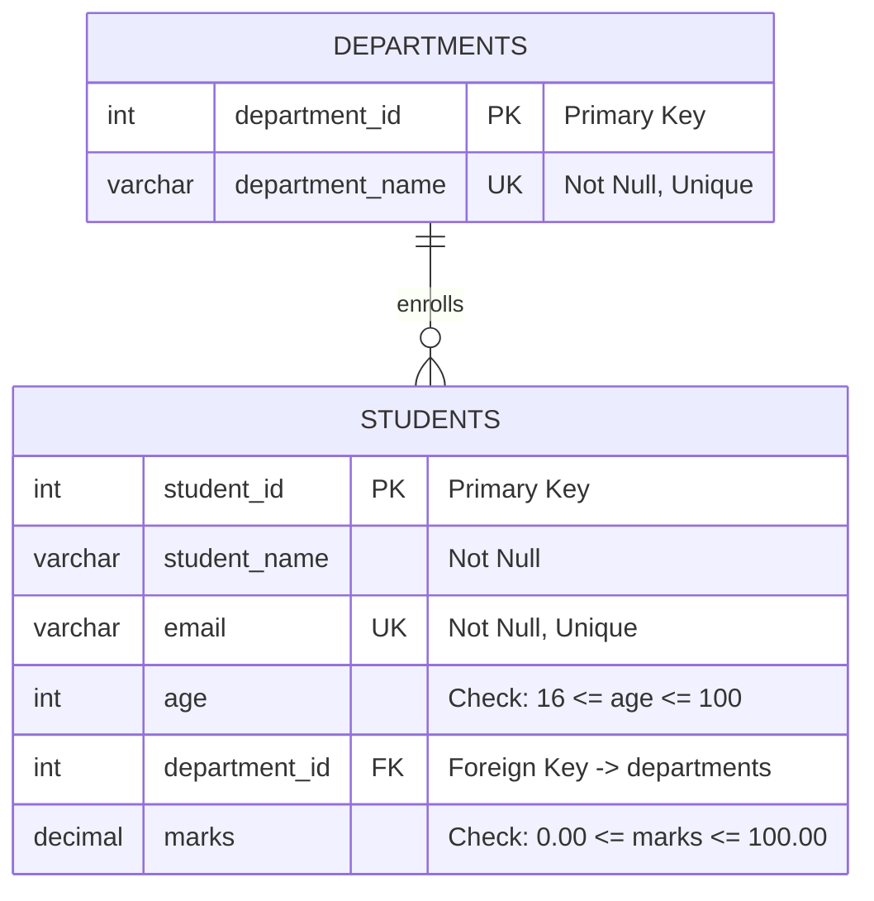

# 🎓 Student Management System — Database & Functional Testing Portfolio

[](sql/setup_database.sql)
[](test-cases/Student_Database_Test_Cases.md)
[](reports/Test_Execution_Report.pdf)
[](sql/setup_database.sql)
[](#repository-artifacts)

A comprehensive, industry-grade **Database QA & Functional Testing Portfolio Project** validating data consistency, referential integrity, domain constraints, and analytical SQL queries for a relational **Student Management System** (`student_qa`).

---

## 📌 Project Overview

In software quality assurance, database testing ensures that the application's underlying data store reliably enforces business rules, maintains relational integrity, blocks illegal values, and handles transactions safely under ACID principles.

This project simulates real-world database testing against a normalized relational schema (`departments` and `students`), executing:
- **CRUD Operations:** Validating data persistence across inserts, updates, and deletions.
- **Integrity Constraints:** Testing Primary Keys, Foreign Keys, Unique indices, and NOT NULL rules.
- **Boundary Value Analysis (BVA):** Validating CHECK constraints on age (16–100) and marks (0.00–100.00).
- **Referential Integrity:** Preventing orphaned records and unauthorized parent deletions (`ON DELETE RESTRICT`).
- **Data Auditing & Analysis:** Writing complex SQL queries using multi-table JOINs, `GROUP BY`, `HAVING`, and aggregate functions (`COUNT`, `AVG`, `MIN`, `MAX`).

---

## 📐 Database Schema & Entity-Relationship (ER) Diagram



---

## 📁 Repository Artifacts

```
student-management-database-testing/
├── README.md
├── run_database_tests.py
├── sql/
│   ├── setup_database.sql
│   ├── test_crud_operations.sql
│   └── validation_queries.sql
├── test-cases/
│   ├── Student_Database_Test_Cases.md
│   └── Student_Database_Test_Cases.xlsx
├── bug-reports/
│   ├── Bug_Reports.md
│   └── Bug_Reports.xlsx
└── reports/
    ├── Test_Execution_Report.md
    └── Test_Execution_Report.pdf
```

| File / Folder | Format | Description |
|:---|:---:|:---|
| **[`sql/setup_database.sql`](sql/setup_database.sql)** | SQL | Schema definitions, table creation, constraints, and initial seed records. |
| **[`sql/test_crud_operations.sql`](sql/test_crud_operations.sql)** | SQL | Individual test execution scripts for positive/negative CRUD and constraint checks. |
| **[`sql/validation_queries.sql`](sql/validation_queries.sql)** | SQL | Advanced analytical and audit queries (INNER/LEFT JOIN, GROUP BY, HAVING, AVG). |
| **[`test-cases/Student_Database_Test_Cases.xlsx`](test-cases/Student_Database_Test_Cases.xlsx)** | Excel | Formatted workbook of all 20 test cases with queries, expected vs. actual results. |
| **[`test-cases/Student_Database_Test_Cases.md`](test-cases/Student_Database_Test_Cases.md)** | Markdown | Markdown version of the 20 database test cases. |
| **[`bug-reports/Bug_Reports.xlsx`](bug-reports/Bug_Reports.xlsx)** | Excel | Jira-style defect log of edge cases, collation quirks, and engine compatibility risks. |
| **[`reports/Test_Execution_Report.pdf`](reports/Test_Execution_Report.pdf)** | PDF | Executive-ready PDF test report with metrics, category breakdown, and sign-off. |
| **[`run_database_tests.py`](run_database_tests.py)** | Python | Automated test runner verifying constraint enforcement and generating all reports. |

---

## 🎯 Test Categories & Methodology

### 1. CRUD Operations & Persistence
- **Create (Insert):** Insert valid student records and verify row presence via `SELECT`.
- **Read (Query):** Retrieve specific records by primary key with expected field values.
- **Update (Modify):** Update specific columns (e.g., student marks to 95.00) while ensuring unrelated attributes remain unchanged.
- **Delete (Removal):** Remove dedicated test records and verify 0 rows are returned upon query.
- **ACID Transaction Verification:** Verifying data commit persistence across independent sessions.

### 2. Constraint & Integrity Validation
- **Primary Key (PK):** Attempt inserting duplicate `student_id` (101) $\rightarrow$ Rejected with PK violation.
- **NOT NULL:** Attempt inserting `NULL` for `student_name` or `email` $\rightarrow$ Rejected by database engine.
- **Unique Constraint (UK):** Attempt inserting registered email (`aarav@example.com`) $\rightarrow$ Rejected with duplicate key violation.
- **Foreign Key (FK):** Attempt assigning student to non-existent `department_id = 999` $\rightarrow$ Rejected with FK failure.
- **Referential Restrict:** Attempt deleting parent department with active students $\rightarrow$ Blocked by `ON DELETE RESTRICT`.

### 3. Boundary Value Analysis (BVA) on CHECK Constraints
| Field | Valid Range | Test Input | Expected Database Behavior | Status |
|:---|:---:|:---:|:---|:---:|
| **Age** | $16 \le \text{age} \le 100$ | `10` (Below Min) | Rejected (`chk_student_age` violation) | **PASS** |
| **Age** | $16 \le \text{age} \le 100$ | `105` (Above Max) | Rejected (`chk_student_age` violation) | **PASS** |
| **Marks** | $0.00 \le \text{marks} \le 100.00$ | `-10.00` (Negative) | Rejected (`chk_student_marks` violation) | **PASS** |
| **Marks** | $0.00 \le \text{marks} \le 100.00$ | `125.00` (Excess) | Rejected (`chk_student_marks` violation) | **PASS** |

---

## 📊 Analytical SQL Queries Demonstrated

### 1. Departmental Student Count (LEFT JOIN + GROUP BY)
```sql
SELECT d.department_name, COUNT(s.student_id) AS total_students
FROM departments d
LEFT JOIN students s ON d.department_id = s.department_id
GROUP BY d.department_id, d.department_name;
```
*Purpose:* Ensures departments with zero enrolled students still appear in administrative reports.

### 2. Duplicate Email Audit (GROUP BY + HAVING)
```sql
SELECT email, COUNT(*) AS occurrence_count
FROM students
GROUP BY email
HAVING COUNT(*) > 1;
```
*Purpose:* Audits data hygiene. Returning 0 rows confirms complete uniqueness across user records.

### 3. Departmental Performance Analytics (AVG, MIN, MAX)
```sql
SELECT 
    d.department_name,
    COUNT(s.student_id) AS student_count,
    ROUND(AVG(s.marks), 2) AS average_marks,
    MIN(s.marks) AS minimum_marks,
    MAX(s.marks) AS maximum_marks
FROM departments d
LEFT JOIN students s ON d.department_id = s.department_id
GROUP BY d.department_id, d.department_name;
```

---

## 🐛 Documented Defect & Risk Scenarios

| Defect ID | Severity | Category | Summary |
|:---:|:---:|:---|:---|
| **DB-BUG-01** | High | Engine Compatibility | Legacy MySQL engines (< 8.0.16) parse but silently ignore `CHECK` constraints. |
| **DB-BUG-02** | Medium | Data Sanitization | Trailing whitespace in emails (`'aarav@example.com '`) can bypass validation in pad-space collations. |
| **DB-BUG-03** | Medium | Referential Integrity | Deleting a parent department raises raw engine error (1451) rather than a graceful API message. |
| **DB-BUG-04** | Low | Precision Handling | Non-strict SQL modes silently truncate out-of-scale decimal marks. |

---

## 🚀 How to Run the Tests

### Option A: Using MySQL Workbench
1. Open **MySQL Workbench** and connect to your local MySQL Server.
2. Open and execute `sql/setup_database.sql` to initialize tables and seed data.
3. Open `sql/test_crud_operations.sql` and run individual test blocks to observe constraint rejections.
4. Open and run `sql/validation_queries.sql` to review analytical reports.

### Option B: Automated Execution via Python
Run the included standalone runner (requires Python 3):
```powershell
python run_database_tests.py
```
This script executes the full suite in an in-memory ANSI SQL database, verifies constraint enforcement, and regenerates the `.xlsx` and `.pdf` reports.

---

## 💼 Resume Bullet Points

```markdown
• Designed and executed 20 database test cases for a Student Management System validating CRUD operations, ACID properties, and relational data integrity.
• Tested entity constraints (Primary Key, Foreign Key, Unique, NOT NULL) and applied Boundary Value Analysis to enforce CHECK constraints on numeric fields.
• Authored complex SQL validation queries leveraging INNER/LEFT JOINs, GROUP BY, HAVING, and aggregate statistical functions (AVG, MIN, MAX) for data auditing.
• Documented database risk scenarios and engine compatibility limits (MySQL 8.0+ CHECK constraint enforcement); produced IEEE test artifacts and PDF execution reports published on GitHub.
```
